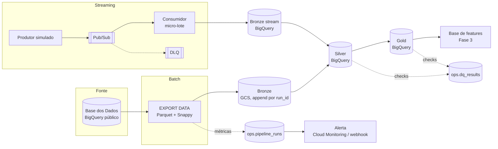

# Arquitetura

> Proposta inicial. Atualizar o diagrama para refletir apenas o que foi implementado antes da entrega.

## Entidades

| Entidade | Tabela fonte | Usada em |
|---|---|---|
| Dados de alunos | `alunos` | _TODO_ |
| Município | `municipio` | _TODO_ |
| UF | `uf` | _TODO_ |
| Meta Brasil | `meta_alfabetizacao_brasil` | _TODO_ |
| Meta UF | `meta_alfabetizacao_uf` | _TODO_ |
| Meta município | `meta_alfabetizacao_municipio` | _TODO_ |
| Dicionário | `dicionario` | _TODO_ |

Todas as seis entidades precisam aparecer na Gold de alguma forma. Tabela ingerida e não usada conta contra.
